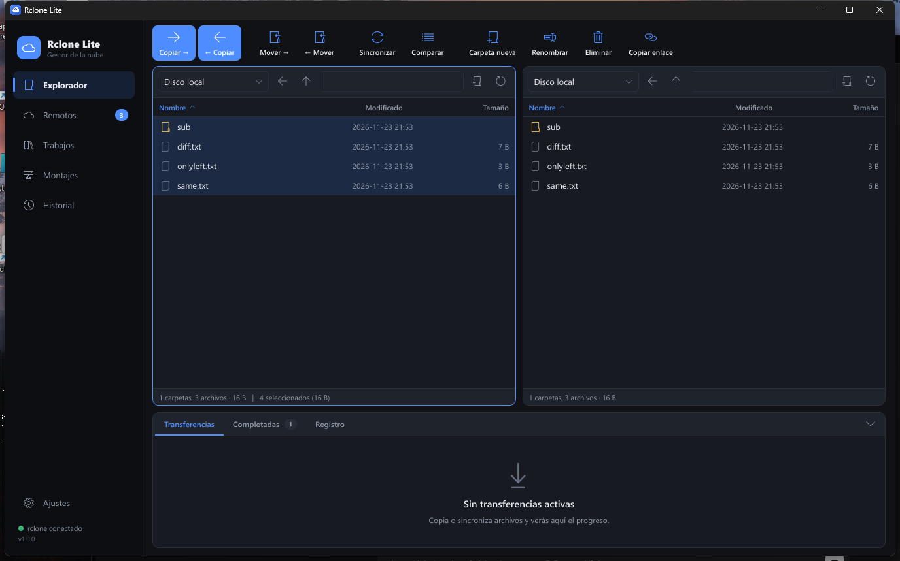
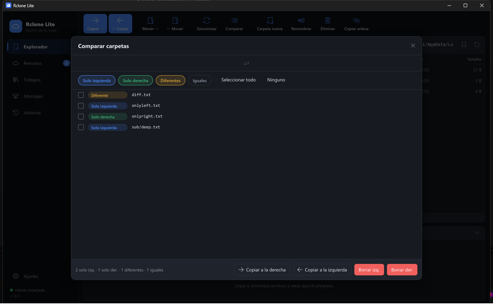

<div align="center">

# Rclone Lite

### Un gestor de archivos en la nube gratuito, de código abierto y para Windows.

[](#requisitos)
[](#compilar-desde-el-código)
[](https://slint.dev)
[](LICENSE)
[](https://rclone.org)

**Dos paneles. Tus nubes. Tus archivos bajo control.**

[Descargar para Windows](https://github.com/GonzaloCN-Dev/rclone-lite/releases/latest) ·
[Funciones](#funciones) · [Instalar](#instalación) · [Informar un problema](https://github.com/GonzaloCN-Dev/rclone-lite/issues)

</div>

Rclone Lite es una interfaz gráfica en español para [rclone](https://rclone.org): explora, compara y transfiere archivos entre unidades locales y servicios en la nube. Gratis, sin límites Plus ni suscripción. Desarrollado por **Gonzalo Cruz Nuñez**.

> **Aviso:** Rclone Lite es un proyecto independiente de código abierto; no está afiliado con el equipo de rclone.

## Capturas

| Explorador de dos paneles | Comparar carpetas |
| --- | --- |
|  |  |

## Funciones

| Función | Qué puedes hacer |
| --- | --- |
| **Explorador de dos paneles** | Trabajar con disco local y remotos; copiar, mover, renombrar, borrar, crear carpetas y copiar enlaces. Atajos F2, F5–F8. |
| **Comparar carpetas** | Identificar elementos exclusivos de cada lado, diferencias y coincidencias; elegir elementos y copiar o borrar. |
| **Trabajos** | Copiar, sincronizar o mover; vista previa obligatoria antes de aplicar una sincronización; varios destinos 1:N; filtros; programación con la próxima ejecución visible y opción de ejecutarlos aunque la app esté cerrada; importar y exportar JSON con revisión y sanitización. |
| **Remotos** | Administrar remotos y configurarlos con el asistente de rclone para Drive, OneDrive, Dropbox, S3, SFTP, WebDAV, MEGA y más; credenciales propias de Google Drive incluidas. |
| **Montajes** | Montar un remoto como unidad de Windows (requiere [WinFsp](https://winfsp.dev)). |
| **Seguimiento** | Ver transferencias con su velocidad (KB/s o MB/s) y una gráfica en tiempo real, elementos completados e historial de operaciones; confirmación antes de salir si hay transferencias activas. Rclone Lite evita iniciar otra transferencia mientras una sigue en curso. |
| **Velocidad en Google Drive** | Ajusta rclone automáticamente para remotos de Drive (más transferencias en paralelo y ritmo de peticiones más rápido): en pruebas con archivos pequeños fue unas 3 veces más rápido (de ~0,7 a ~2,4 archivos por segundo; el ritmo exacto depende del momento y de tu cuenta). Se puede desactivar en Ajustes. |
| **Actualizaciones** | Avisa cuando hay una versión nueva en GitHub y la instala sola, cerrando y reabriendo la aplicación. Se puede desactivar en Ajustes. |
| **Bandeja y avisos** | Mantener la aplicación en la bandeja, recibir notificaciones al terminar y evitar instancias duplicadas. |
| **Personalización** | Interfaz en español, temas oscuro y claro y confirmación antes de borrar. |
| **Protección de copias** | Opción para no reemplazar archivos más nuevos en el destino. |

## Instalación

1. Descarga **`RcloneLite-Setup-1.6.0.exe`** desde [la última versión](https://github.com/GonzaloCN-Dev/rclone-lite/releases/latest).
2. Ejecuta el instalador. No requiere permisos de administrador para instalarse en tu usuario.
3. Inicia Rclone Lite desde el menú Inicio.

El instalador incluye el runtime de Visual C++ y comprueba si **rclone** y **WinFsp** están en el equipo: si faltan, te ofrece descargarlos e instalarlos (con verificación SHA-256). **WinFsp solo es necesario para montar unidades.** El instalador es x64 para Windows 10/11. No está firmado, por lo que Windows SmartScreen puede mostrar un aviso de editor desconocido.

También puedes descargar el instalador directamente: **[RcloneLite-Setup-1.6.0.exe](https://github.com/GonzaloCN-Dev/rclone-lite/releases/download/v1.6.0/RcloneLite-Setup-1.6.0.exe)**.

## Requisitos

- Windows 10 u 11 de 64 bits.
- Para desarrollar: Visual Studio 2022/2026 con C++ y CMake, Rust estable, Ninja e Inno Setup 6 para compilar el instalador.
- Conexión a Internet en la primera compilación, para descargar Slint y nlohmann/json.

### Tecnologías

C++20, [Slint](https://slint.dev), [rclone](https://rclone.org) y [nlohmann/json](https://github.com/nlohmann/json).

## Compilar desde el código

```powershell
cmd /c .\build.bat
```

El ejecutable queda en `build\RcloneLite.exe`, junto a `slint_cpp.dll`. Para generar el instalador, instala [Inno Setup 6](https://jrsoftware.org/isinfo.php) y ejecuta:

```powershell
powershell -ExecutionPolicy Bypass -File .\installer\build-installer.ps1
```

El instalador queda en `dist\RcloneLite-Setup-1.6.0.exe`.

Las pruebas unitarias y de integración se ejecutan con `ctest --test-dir build --output-on-failure`. Para la integración con rclone real, define `RCLONE_EXE` con la ruta a `rclone.exe`; si no está definida, esa prueba se omite.

## Datos y privacidad

La configuración, trabajos e historial de la aplicación se guardan localmente en `%APPDATA%\RcloneLite`. Los trabajos programados se ejecutan mientras Rclone Lite está abierto; si activas la opción correspondiente, también pueden ejecutarse con la ventana cerrada mientras tu sesión de Windows siga iniciada. Las credenciales y remotos son gestionados por rclone según su propia configuración. Rclone Lite no requiere una cuenta propia ni un servicio de nube intermediario.

## Licencias

El código original de Rclone Lite se ofrece bajo [MIT](LICENSE). Rclone Lite integra componentes con sus propias licencias; consulta [`installer/LICENSES.txt`](installer/LICENSES.txt). Slint requiere mostrar su atribución: está incluida en **Ajustes → Acerca de**.

## Contribuir

¡Las ideas, informes de errores y contribuciones son bienvenidos! Abre un [issue](https://github.com/GonzaloCN-Dev/rclone-lite/issues) para informar de un problema o proponer una mejora. Antes de abrir un PR grande, crea un issue para conversar el enfoque.

## Créditos

Creado por **Gonzalo Cruz Nuñez**. Interfaz construida con [Slint](https://slint.dev); motor de transferencias [rclone](https://rclone.org); JSON con [nlohmann/json](https://github.com/nlohmann/json).

---

<div align="center">
Hecho con cuidado para que gestionar tus archivos en la nube sea más sencillo.
</div>

## English

**Rclone Lite** is a free, open-source Windows GUI for [rclone](https://rclone.org). Browse local drives and cloud remotes side by side, compare folders, and run copy, sync or move jobs—with no subscription or Plus-tier limits.

### Features

- Dual-pane file explorer for local drives and cloud remotes.
- Color-coded folder comparison, with selective copy and delete actions.
- Copy, sync and move jobs; dry-run, filters, 1-to-many destinations, scheduling and JSON import/export.
- Remote management and rclone configuration wizard for Drive, OneDrive, Dropbox, S3, SFTP, WebDAV, MEGA and more.
- Windows drive mounts (requires [WinFsp](https://winfsp.dev)).
- Transfer status with live speed (KB/s or MB/s) and a real-time chart, completed items, history, system tray and Windows notifications.
- Built-in updater: checks GitHub releases, verifies the download and installs it automatically.
- Spanish interface; dark and light themes.
- Optional Windows Task Scheduler integration to run scheduled jobs while the app is closed (the Windows user session must remain signed in).

### Download

Download **[RcloneLite-Setup-1.6.0.exe](https://github.com/GonzaloCN-Dev/rclone-lite/releases/latest)** for 64-bit Windows 10/11. The installer includes the Visual C++ runtime and offers to download rclone and WinFsp (SHA-256 verified) when they are missing. WinFsp is only needed for drive mounts. The installer is unsigned, so SmartScreen may warn about an unknown publisher.

### Build

Requirements: Visual Studio C++/CMake, stable Rust, Ninja and Inno Setup 6. Run `build.bat` to build the app, or `powershell -ExecutionPolicy Bypass -File .\installer\build-installer.ps1` to build the installer.

Original Rclone Lite code is MIT-licensed; third-party components retain their own licenses. See [`installer/LICENSES.txt`](installer/LICENSES.txt). Created by **Gonzalo Cruz Nuñez**.
